<div align="center">

  <!-- Custom Tokyo Night Animated Hero Banner -->
  

  <br />

  <!-- Animated Typing SVG Extension -->
  <a href="https://github.com/Abrar2212">
    
  </a>

  <!-- Quick Links & Social Extensions -->
  <p align="center">
    <a href="https://junaed.vercel.app/" target="_blank">
      
    </a>
    <a href="mailto:abrarjunaed22@gmail.com">
      
    </a>
    <a href="https://www.linkedin.com" target="_blank">
      
    </a>
    <a href="https://www.facebook.com/abrar.junaed.2025" target="_blank">
      
    </a>
    <a href="https://www.instagram.com/abrar_junaed/" target="_blank">
      
    </a>
    
  </p>

</div>

---

## ⚡ About Me

<table>
  <tr>
    <td width="58%" valign="top">
      <p>
        I'm <b>Abrar Junaed</b>, a Computer Science &amp; Engineering undergraduate at <b>United International University (UIU)</b> passionate about architecting fast, resilient, and thoughtfully designed software systems from database to browser.
      </p>
      <ul>
        <li>🔭 <b>Currently Researching:</b> <i>Calibrated Non-Visual Confidence Communication</i> for egocentric episodic memory recall (FYDP) using <b>Google Gemini VLMs</b> &amp; <b>OpenCV</b></li>
        <li>🚀 <b>Shipping Full-Stack Products:</b> Interactive 3D web platforms (<b>Next.js 16 + Three.js</b>), gamified learning systems (<b>Spring Boot 3 + React</b>), and modular backends (<b>NestJS + PostgreSQL</b>)</li>
        <li>🤖 <b>Beyond the Web:</b> Multi-agent AI workflows, automated research assistants, and vision-guided robotics (<b>Raspberry Pi 5 + Arduino</b>)</li>
        <li>📫 <b>Reach me at:</b> <a href="mailto:abrarjunaed22@gmail.com"><code>abrarjunaed22@gmail.com</code></a></li>
      </ul>
    </td>
    <td width="42%" valign="top">

```yaml
name: Abrar Junaed
education: B.Sc. in CSE @ UIU
location: Dhaka, Bangladesh

engineering_focus:
  - Full-Stack Web Architecture
  - Scalable REST APIs & Auth
  - Interactive 3D Web (R3F / STL)
  - Multimodal AI & Vision Agents

principles:
  - Clean modular architecture
  - Zero-latency optimistic UX
  - Type-safe end-to-end systems
```

  </td>
  </tr>
</table>

---

## 🛠️ Tech Stack & Engineering Arsenal

<table width="100%">
  <tr>
    <td width="50%" valign="top">
      <h3 align="center">💻 Languages</h3>
      <p align="center">
        
      </p>
      <p align="center">
        
        
        
      </p>
    </td>
    <td width="50%" valign="top">
      <h3 align="center">🎨 Frontend, 3D &amp; Motion</h3>
      <p align="center">
        
      </p>
      <p align="center">
        
        
        
        
      </p>
    </td>
  </tr>
  <tr>
    <td width="50%" valign="top">
      <h3 align="center">⚙️ Backend &amp; API Architecture</h3>
      <p align="center">
        
      </p>
      <p align="center">
        
        
        
        
      </p>
    </td>
    <td width="50%" valign="top">
      <h3 align="center">🗄️ Databases, Cloud &amp; DevOps</h3>
      <p align="center">
        
      </p>
      <p align="center">
        
        
        
      </p>
    </td>
  </tr>
  <tr>
    <td colspan="2" valign="top">
      <h3 align="center">🧠 Applied AI, Computer Vision &amp; Embedded Robotics</h3>
      <p align="center">
        
      </p>
      <p align="center">
        
        
        
        
      </p>
    </td>
  </tr>
</table>

---

## 🚀 Featured Engineering Projects

<table width="100%">
  <tr>
    <td width="50%" valign="top">
      <h3>🖨️ <a href="https://github.com/Abrar2212/Printx3d">PrintX3D</a></h3>
      <p><b>Interactive 3D Keychain Customizer &amp; On-Demand Printing Platform</b></p>
      <p>
        Real-time 3D customization studio where customers preview multi-line text, fonts, and dual-filament colors in 3D while staff export exact print-ready procedural <b>STL meshes</b>. Includes role-based operator/admin queues, privacy-safe order tracking, and an embeddable <b>WordPress customizer plugin</b>.
      </p>
      <p>
        <a href="https://printx3d.onrender.com"></a>
        <a href="https://github.com/Abrar2212/Printx3d"></a>
      </p>
      <p><code>Next.js 16</code> · <code>React 19</code> · <code>Three.js / R3F</code> · <code>Prisma</code> · <code>PostgreSQL</code> · <code>WordPress</code></p>
    </td>
    <td width="50%" valign="top">
      <h3>🎓 <a href="https://github.com/Abrar2212/LearnMatrix">LearnMatrix</a></h3>
      <p><b>Gamified Full-Stack Learning &amp; Online Judge Platform</b></p>
      <p>
        Enterprise-grade interactive learning ecosystem featuring structured courses, quizzes, an embedded <b>Monaco code editor</b>, and full gamification (XP, coins, badges, peer challenges, and live leaderboards) backed by JWT &amp; Google OAuth2 authentication.
      </p>
      <p>
        <a href="https://github.com/Abrar2212/LearnMatrix"></a>
      </p>
      <p><code>Spring Boot 3</code> · <code>Java 21</code> · <code>React</code> · <code>TypeScript</code> · <code>MySQL</code> · <code>OAuth2</code></p>
    </td>
  </tr>
  <tr>
    <td width="50%" valign="top">
      <h3>🤝 <a href="https://github.com/Abrar2212/Skill_Binimoy">Skill Binimoy</a></h3>
      <p><b>Peer-to-Peer Skill Barter &amp; Live Mentorship Marketplace</b></p>
      <p>
        Zero-cost community knowledge exchange platform enabling learners to trade skills via two-way exchange proposals, integrated <b>1-on-1 Jitsi video sessions</b>, real-time peer messaging, reputation tracking, and an embedded AI learning assistant.
      </p>
      <p>
        <a href="https://github.com/Abrar2212/Skill_Binimoy"></a>
      </p>
      <p><code>React 19</code> · <code>TypeScript</code> · <code>Node.js</code> · <code>Express</code> · <code>Firebase</code> · <code>GSAP</code></p>
    </td>
    <td width="50%" valign="top">
      <h3>🌟 <a href="https://github.com/Abrar2212/Starry-Wrap">Starry-Wrap</a></h3>
      <p><b>High-Performance Inventory &amp; Retail Operations Suite</b></p>
      <p>
        Full-stack business management dashboard engineered for <b>&lt;60ms API responses</b> and <b>0-latency optimistic UI mutations</b>, featuring concurrent multi-image Cloudinary streaming, HTTP-only JWT security, and 6-digit OTP email verification.
      </p>
      <p>
        <a href="https://github.com/Abrar2212/Starry-Wrap"></a>
      </p>
      <p><code>React 19</code> · <code>TypeScript</code> · <code>Express 5</code> · <code>PostgreSQL</code> · <code>Cloudinary</code></p>
    </td>
  </tr>
  <tr>
    <td width="50%" valign="top">
      <h3>🧠 Non-Visual Confidence Recall</h3>
      <p><b>Assistive Egocentric Episodic Memory AI (FYDP Research)</b></p>
      <p>
        Assistive vision-language pipeline for blind and low-vision smart-glass users. Combines temporal video segmentation, semantic keyframe indexing, and <b>Google Gemini VLMs</b> to deliver calibrated confidence communication (answer, qualify, verify, or abstain).
      </p>
      <p>
        
      </p>
      <p><code>Python</code> · <code>Google Gemini VLM</code> · <code>OpenCV</code> · <code>Scikit-Learn</code></p>
    </td>
    <td width="50%" valign="top">
      <h3>🤖 <a href="https://github.com/Abrar2212/Autonomous-Restaurant-Service-Robot">Autonomous Service Robot</a></h3>
      <p><b>Computer-Vision Guided Table Delivery Robot</b></p>
      <p>
        Low-cost autonomous restaurant delivery system uniting a <b>Raspberry Pi 5</b> vision unit (OpenCV ArUco marker table recognition &amp; request detection) with an <b>Arduino Nano</b> IR-sensor navigation controller over serial communication.
      </p>
      <p>
        <a href="https://github.com/Abrar2212/Autonomous-Restaurant-Service-Robot"></a>
      </p>
      <p><code>C++</code> · <code>Python</code> · <code>OpenCV</code> · <code>Raspberry Pi 5</code> · <code>Arduino Nano</code></p>
    </td>
  </tr>
</table>

<details>
  <summary><b>📂 Explore More Projects &amp; Systems (Scholarship Scout, Qasar, Home Hunt)</b></summary>
  <br />
  <table>
    <thead>
      <tr>
        <th align="left">Project</th>
        <th align="left">Architecture &amp; Highlights</th>
        <th align="left">Core Stack</th>
      </tr>
    </thead>
    <tbody>
      <tr>
        <td><b>🎯 Scholarship Scout</b></td>
        <td>AI university &amp; scholarship research agent that verifies official university domain sources, evaluates profile eligibility, and drafts human-reviewed Gmail enquiries.</td>
        <td><code>Next.js 16</code> · <code>Gemini AI</code> · <code>Prisma</code> · <code>PostgreSQL</code> · <code>Gmail API</code></td>
      </tr>
      <tr>
        <td><b>✨ Qasar</b></td>
        <td>Modular-monolith e-commerce platform with dedicated Auth, Inventory, Cart, Order, Payment, and Admin reporting modules.</td>
        <td><code>NestJS</code> · <code>React 19</code> · <code>TypeScript</code> · <code>PostgreSQL</code> · <code>GSAP</code></td>
      </tr>
      <tr>
        <td><b>🏠 <a href="https://github.com/Abrar2212/Home-Hunt">Home Hunt</a></b></td>
        <td>Full-stack real-estate &amp; rental discovery platform with multi-criteria property search filters, user authentication, and admin CRUD dashboard.</td>
        <td><code>PHP</code> · <code>MySQL</code> · <code>React</code> · <code>Node.js</code></td>
      </tr>
    </tbody>
  </table>
</details>

---

## 📊 GitHub Analytics & Activity Extensions

<div align="center">

  <!-- Row 1: GitHub Stats + Contribution Streak -->
  
  &nbsp;
  

  <br /><br />

  <!-- Row 2: Top Languages + Profile Repo Breakdown -->
  
  &nbsp;
  

  <br /><br />

  <!-- Row 3: Full-Width Contribution Activity Graph Extension -->
  

</div>

<!--
  🐍 Contribution Snake Extension (Auto-generated once pushed via .github/workflows/snake.yml):
  Uncomment the block below after pushing to main and letting the "Generate Contribution Snake" GitHub Action run once:

  <div align="center">
    <picture>
      <source media="(prefers-color-scheme: dark)" srcset="https://raw.githubusercontent.com/Abrar2212/Abrar2212/output/github-contribution-grid-snake-dark.svg" />
      <source media="(prefers-color-scheme: light)" srcset="https://raw.githubusercontent.com/Abrar2212/Abrar2212/output/github-contribution-grid-snake.svg" />
      
    </picture>
  </div>
-->

<br />

<!-- Tokyo Night Animated Wave Footer Extension -->
<div align="center">
  
</div>
